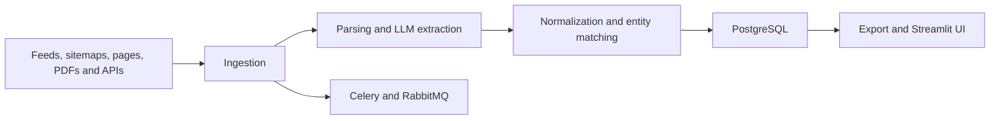

# Tender and Project Intelligence Pipeline

**A multi-source document/data pipeline for project and tender ingestion, parsing, normalization, entity matching, enrichment and export.**

Project records arrive through feeds, sitemaps, pages, PDFs and specialized source APIs. They differ in identifiers, field formats, completeness and update timing. This implementation separates source adapters from extraction, normalization and matching so that merged records can be examined against the originating material.

## Architecture and data flow



## Implementation decisions

1. Ingestion adapters and pure field-normalization helpers are separate from FastAPI, queues and the UI. This allows selected data transformations to run without production infrastructure.

2. Matching exposes field differences as well as a heuristic similarity score. That score is not a calibrated probability that two records describe the same entity.

3. Lazy service exports avoid eagerly creating database or LLM dependencies when importing pure matching/normalization functions.

4. LLM extraction and downstream normalization are different stages. A well-formed normalized value can still be incorrect if it was extracted from the wrong source span.

5. Queue-driven ingestion needs explicit idempotency, resume and source-provenance checks before repeated imports can be treated as reliable operations.

6. Specialized data providers retain their own access terms. The prepared copy contains adapters and configuration structure, without account credentials or bulk customer/source exports.

## Source navigation

| Module | Responsibility |
| --- | --- |
| `backend/app/services/pipeline.py` | Ingestion and enrichment orchestration |
| `backend/app/services/normalize.py` | Date, phone and currency normalization |
| `backend/app/services/matching.py` | Entity similarity and field differences |
| `backend/app/services/seldon_service.py` | Specialized source adapter |
| `backend/app/services/exporter.py` | Export boundary |
| `frontend` | Streamlit interface |

## Reproducible component checks

The minimal checks use Python 3.11/3.12 and `requirements-checks.txt`. They are independent of live accounts, paid APIs and GPU inference. They exercise the specific boundary described below; they are not a measurement of the complete application's model quality.

Linux/macOS, from the repository root:

```bash
python3.11 -m venv .venv
.venv/bin/python -m pip install -r requirements-checks.txt
.venv/bin/python offline_demo.py
.venv/bin/python -m unittest discover -s tests/offline -v
.venv/bin/python scripts/check_source.py
```

Windows PowerShell, from the repository root:

```powershell
py -3.11 -m venv .venv
& ./.venv/Scripts/python.exe -m pip install -r requirements-checks.txt
& ./.venv/Scripts/python.exe offline_demo.py
& ./.venv/Scripts/python.exe -m unittest discover -s tests/offline -v
& ./.venv/Scripts/python.exe scripts/check_source.py
```

### What the replay actually verifies

Two generated records are normalized and compared by the existing helpers. The demonstration covers date/currency conversion, matching-score boundaries and source URLs from a sitemap. It does not invoke paid APIs, evaluate LLM extraction or import a complete dataset into PostgreSQL.

The recorded example output is in [docs/offline-demo-output.json](docs/offline-demo-output.json). CI checks the minimal suite separately from a Gitleaks secret scan. Source compilation verifies syntax; it does not instantiate every runtime integration.

## Full runtime and configuration

The backend uses `backend/requirements.txt`, PostgreSQL and RabbitMQ/Celery; the interface uses `frontend/requirements.txt`. Review local configuration and Docker Compose before starting the full stack. The configured backend port is 8001 and Streamlit port is 8501. Pure utility checks do not require those services or access to specialized provider APIs.

Runtime dependencies and configuration notes are documented in [docs/runtime.md](docs/runtime.md). Minimal and full-runtime environments are intentionally separate. Filled local settings, credentials, production exports and original Git history are outside the source export. Configuration examples describe shape and environment references; they are not a working customer account.

## Evaluation protocol

A permitted, independently labeled document set is needed for field-level extraction precision/recall and duplicate-detection precision/recall. Evaluate matching thresholds on held-out entities rather than tuning against the same examples used for reporting. Integration checks should cover repeated imports, interrupted jobs, conflicting fields, source provenance and export consistency.

## Current boundaries

- No learned entity-resolution or independently evaluated extraction model is claimed.
- Heuristic matching scores require threshold validation for each data domain.
- A utility replay does not verify the complete queued ingestion workflow.

This repository presents the reviewed, anonymized source and the reproducible component checks described above. Private account configuration, customer identities, production documents, recordings and original deployment settings are excluded. Full application-level evaluation remains separate from the offline checks.

## Provenance and dependencies

The source export belongs to the author's local project family; technical component boundaries are recorded in [docs/source-provenance.json](docs/source-provenance.json). Third-party libraries, pretrained models and adapters retain their own licenses and attribution; see [THIRD_PARTY.md](THIRD_PARTY.md). No new permissive license is assigned by this documentation update.

Where present, [docs/original-guide.md](docs/original-guide.md) preserves the implementation guide with neutralized service names. It is reference material and must be read together with the current runtime and validation boundaries above. It is not a claim of production readiness.

## Public configuration boundary

The shipped `config/sources.yaml` contains an empty source list, and
`config/keywords.yaml` contains generic English demonstration terms with no
regional targeting. They do not contain the original deployment's media list,
search campaign, organization information, or account settings. Offline replay
uses generated fixtures and does not need a real source list.

For an authorized deployment, keep your configuration in ignored
`config/sources.local.yaml` and `config/keywords.local.yaml`, then set
`SOURCES_CONFIG_PATH` and `KEYWORDS_CONFIG_PATH` to those paths. Private settings
can be YAML, JSON, INI, source-code literals or other formats; using `.env` is
not a prerequisite for treating a value as sensitive.
